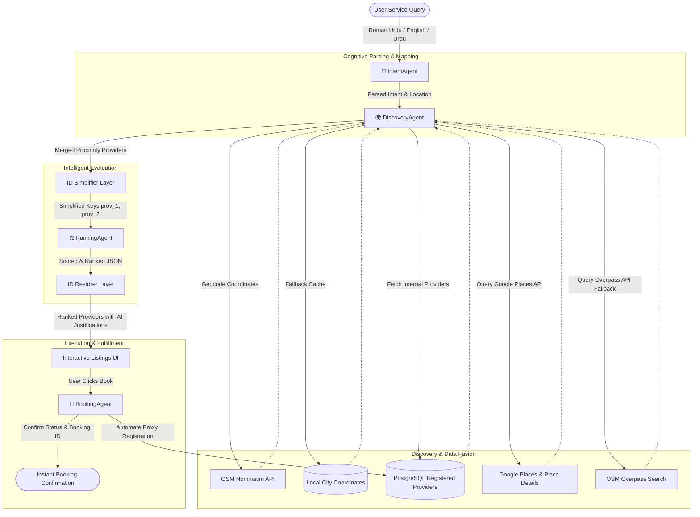

# NearLink Multi-Agent Ecosystem 🧠

This document provides a highly detailed walkthrough of the **NearLink Multi-Agent Architecture**. NearLink utilizes a network of four specialized AI and mathematical agents working in harmony to orchestrate local service discovery, evaluation, ranking, and fulfillment.

---

## 🏗️ Agent Ecosystem Architecture

The following diagram illustrates how user queries traverse the specialized agents of NearLink to deliver structured, high-precision results:

---

## 🤖 Detailed Agent Breakdown

### 1. Intent Parsing Agent (`IntentAgent`)
- **Role**: Parses multi-lingual natural language statements (including Roman Urdu and English code-switching).
- **Core Files**: `backend/app_agents/intent_agent.py`, `intent_agent_fallback.py`
- **Responsibilities**:
  - Semantic classification of service request categories (e.g. `plumber`, `electrician`, `carpenter`).
  - Named Entity Recognition (NER) to extract location parameters (e.g. "DHA Karachi", "Sector G-13 Islamabad").
  - Handles fallback keyword extraction when Gemini is in an outage state.

### 2. Discovery & Geolocation Agent (`DiscoveryAgent` / `osm_search_agent.py`)
- **Role**: Standardizes positions and fetches multi-source provider candidates.
- **Core Files**: `backend/app_agents/osm_search_agent.py`, `google_places_agent.py`
- **Responsibilities**:
  - Translates location strings into exact latitude/longitude decimal degrees.
  - Automatically queries the PostgreSQL database for vetted platform-registered providers.
  - Discovers external local businesses in real-time by querying Google Places API and details (to retrieve active contact phone numbers).
  - Integrates OSM Overpass QL queries as a rate-limit backup discovery channel.

### 3. Smart Suitability & Ranking Agent (`RankingAgent`)
- **Role**: Evaluates provider candidates and decides ranking layout with AI descriptions.
- **Core Files**: `backend/app_agents/ranking_agent.py`
- **Responsibilities**:
  - Formulates a standardized suitability score based on mathematical proximity (Haversine formula), star ratings, and availability metrics.
  - Maps complex 27-character Google `place_id` values to short keys (`prov_1`, `prov_2`) in Gemini prompts to completely eliminate LLM transcription typos and formatting hallucinations.
  - Generates beautiful, user-facing Urdu and English descriptions explaining the logic behind each choice.

### 4. Booking & Slot Fulfillment Agent (`BookingAgent`)
- **Role**: Finalizes connections, records transactions, and updates statuses.
- **Core Files**: `backend/app_agents/booking_agent.py`
- **Responsibilities**:
  - Automatically handles **Proxy Registration**: Creates dynamic database entries in the `Provider` schema for external map businesses on-the-fly when booked. This satisfies rigorous database foreign key constraints without crashing.
  - Simulates booking confirmations, schedules slot reservations, and maintains state change tracking for follows-ups.

---

## 🔄 Sequential Execution Flow

1. **Client Request**: A client posts: *"Bhai pipe leak ho gaya hai kitchen me defence phase 2 me kisi plumber ka number do."*
2. **Intent Parsing**:
   - `IntentAgent` analyzes query $\rightarrow$ service: `plumber`, location: `defence phase 2`.
3. **Geolocation Mapping**:
   - `DiscoveryAgent` triggers Nominatim API $\rightarrow$ translates string to coordinates: `24.8311, 67.0722`.
4. **Candidates Fetching**:
   - Queries platform-registered providers (finds `Ali` in Quaidabad, $18\text{km}$ away).
   - Queries Google Places centering DHA Karachi coordinates $\rightarrow$ finds `Bismillah Enterprises` ($0.47\text{km}$ away) and `ForiFix` ($1.2\text{km}$ away) and appends their real phone numbers.
5. **ID Mapping & AI Ranking**:
   - Merges findings $\rightarrow$ maps IDs to simplified indexes $\rightarrow$ prompts `RankingAgent`.
   - `RankingAgent` computes scores and decides ranking layout:
     - Rank 1: `Bismillah Enterprises` (Proximity Champion, 0.47km away, extremely high rating).
     - Rank 2: `Ali` (Database Verified Champion, supports premium platform features).
6. **Delivery**: UI renders interactive map pins, direct dial phone buttons, and simple check-out.
7. **Booking**: User hits "Book" on Rank 1 $\rightarrow$ `BookingAgent` dynamically registers a shadow Postgres profile for `Bismillah Enterprises` and confirms the slot.

---

## 🧭 Orchestration layer (added on top of the four agents)

The four agents above are now **tools** driven by an `OrchestratorAgent` (`backend/app_agents/orchestrator.py`):

- **Planner:** Gemini (OpenAI Agents SDK function tools) chooses the next tool; `run_policy` is a deterministic planner
  over the *same* tools and takes over if the LLM errors or stops without an outcome. Never make booking depend on the LLM.
- **Tools:** `parse_request` → `search_providers(radius)` → `check_availability(window)` → `rank_candidates` →
  `book_appointment` / `ask_user`. Tool outputs use short keys (`p1`, `p2`) — never expose raw place_ids to the LLM.
- **Time:** `time_resolver.py` converts "kal subah" etc. into UTC windows (PKT = UTC+5, naive UTC in the DB).
- **Slots:** `ProviderSlot` rows are booked hours; free time = working hours − booked rows. A unique
  `(provider_id, start_time)` constraint prevents double booking. The slot row is also the source of truth for a booking's time.
- **Ranking:** numbers are deterministic (`score_provider`); Gemini only writes explanations (`rank_with_breakdown`).
- **Follow-up:** `followup_agent.py` delivers due notifications (APScheduler every 30 s, or `POST /api/followup/tick`) and
  handles cancellations — a provider cancelling triggers an automatic re-run of the orchestrator excluding that provider.
- **Channels:** web (`/agent`, SSE stream), WhatsApp simulator (`/whatsapp`) and Twilio webhook, all calling `run_orchestration`.
- **Trace:** every step is an `AgentTrace` row *and* an SSE event; `GET /api/orchestrator/runs/{request_id}` replays it.
- **Tests:** `cd backend && python -m pytest` (SQLite in memory; discovery and geocoding are stubbed in `tests/conftest.py`).

Note: `routes/unified_search_v2.py` was removed — it was shadowed by `routes/unified_search.py` (same path, registered first).
