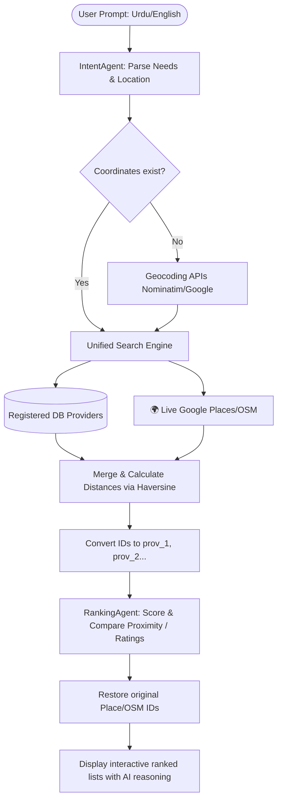

# Reasoning Steps Log: Agent Logic Flow

This document details the cognitive reasoning flow that NearLink's AI agents go through to successfully execute a user request.

## 🧠 Step-by-Step Logic Execution

### Step 1: User Request Parsing (IntentAgent)
When a user submits a search query such as `"Pani ka pipe leak ho raha hai bhai mujh plumber chahye hai defence phase 2 me"`, the `IntentAgent` goes through a semantic analysis:
1. **Urdu Code-Switching translation**: Translates Roman Urdu terms (`leak`, `plumber`) into standard categories.
2. **Entity Extraction**:
   - `service_type` $\rightarrow$ `"Plumber"`
   - `location` $\rightarrow$ `"Defence Phase 2, Karachi"`
3. **Coordinate Lookup**: Searches for spatial indicators to derive boundaries.

### Step 2: Unified Discovery Workflow
The agent orchestrates two simultaneous discovery paths to maximize customer choice:
- **Internal Database**: Queries verified platform-registered providers (e.g. `Ali` in Quaidabad).
- **External Map Services**: Hits Google Places API centered around DHA Karachi coordinates. Discovers real plumbers (e.g. *Bismillah Enterprises*, *ForiFix*) within a 5km radius.

### Step 3: Suitability Scoring & Ranking (RankingAgent)
The model calculates a suitability index based on:
$$\text{Score} = (0.40 \times \text{Rating}) + (0.35 \times \text{Distance Factor}) + (0.25 \times \text{Availability})$$
- AI justifies its selections by explaining why it prefers a closer external business for immediate leaks versus a farther registered provider who supports verified bookings.
